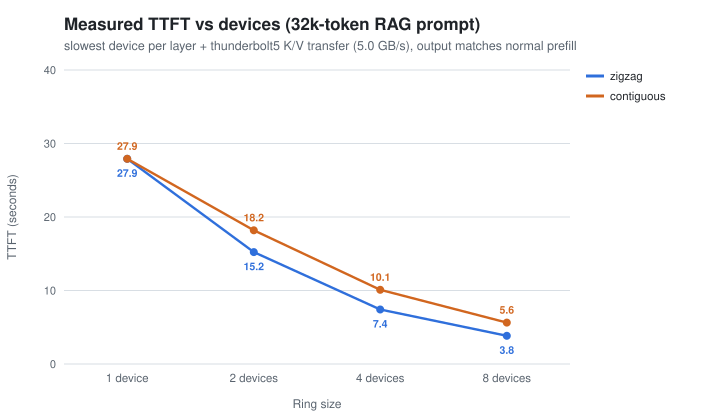
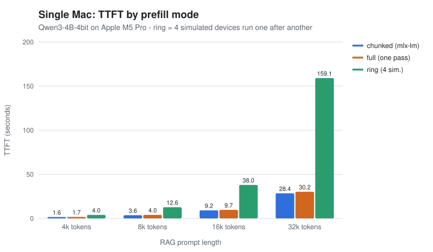
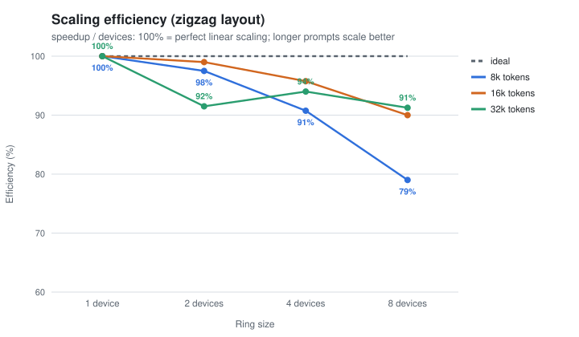

# Ring Attention × long-context RAG: does it cut time-to-first-token?

Experiments with a real LLM (Qwen3-4B, MLX) on an Apple Silicon Mac, measuring
how **Ring Attention** affects **time-to-first-token (TTFT)** for long RAG
prompts (4k–32k tokens). Includes three implementations: a single-process
simulation, a per-device timing harness for a full model, and real multi-process
Ring Attention over `mx.distributed`.



## Key findings

| | |
|---|---|
| **3.8× faster TTFT on 4 devices, 7.3× on 8** | 32k-token RAG prompt: 27.9 s → 7.4 s → 3.8 s (zigzag layout) |
| **Same output** | Logits match normal prefill within bf16 noise, same first token, hidden fact found in every run |
| **Load balance matters** | Causal attention overloads the last device. Zigzag sharding takes 8 devices from 5.0× to 7.3× |
| **Communication is not the bottleneck** | ~0.8 s of K/V transfer per device at Thunderbolt-class speeds, mostly hidden behind compute |
| **KV memory per device ÷ N** | 4.8 GB → 1.2 GB per device on 4 devices at 32k |
| **On one machine it's slower** | 159 s vs 28 s at 32k. The speedup only comes from parallel hardware |

> The multi-device numbers come from timing each device's real share of the work on the
> Mac's GPU ([methodology](docs/methodology.md)), not from a live cluster. Real multi-process
> Ring Attention is implemented and tested ([multi-Mac guide](docs/multi-mac.md)).

---

## Contents

- [What is Ring Attention?](#what-is-ring-attention)
- [Results](#results)
- [Quick start](#quick-start)
- [Repository layout](#repository-layout)
- [How the code works](#how-the-code-works)
- [Limitations](#limitations)
- [Hosted APIs](#what-about-hosted-apis-claude-openai)
- [Roadmap](#roadmap)

## What is Ring Attention?

Ring Attention ([Liu, Zaharia & Abbeel, 2023](https://arxiv.org/abs/2310.01889))
computes **exact** attention over very long sequences by splitting them across N
devices in a ring. Queries stay put; key/value blocks rotate one hop per step;
partial results merge with an **online softmax** (running max + running sum).
After N steps every device has full attention for its tokens.

```
step 0:  dev0 [KV0]   dev1 [KV1]   dev2 [KV2]   dev3 [KV3]
step 1:  dev0 [KV3]   dev1 [KV0]   dev2 [KV1]   dev3 [KV2]     K/V moves →
step 2:  dev0 [KV2]   dev1 [KV3]   dev2 [KV0]   dev3 [KV1]     queries stay
step 3:  dev0 [KV1]   dev1 [KV2]   dev2 [KV3]   dev3 [KV0]
```

TTFT for RAG is mostly **prefill**, and attention cost in prefill grows with the
square of prompt length. Ring Attention spreads that cost across devices.
Full explanation: [docs/how-ring-attention-works.md](docs/how-ring-attention-works.md).

## Results

Setup: Apple M5 Pro (24 GB), MLX 0.32.4, `mlx-community/Qwen3-4B-4bit`. The RAG
prompt is hundreds of retrieved documents with one hidden fact in the middle
(`CRIMSON-OTTER-7731`).

### Experiment 1: prefill modes on a single Mac



| Tokens | chunked (mlx-lm) | full (one pass) | ring (4 sim.) | Peak memory (chunked / full) | Needle found |
|---|---|---|---|---|---|
| 4,086 | 1.56 s | 1.73 s | 3.95 s | 3.9 / 4.9 GB | yes, all modes |
| 8,315 | 3.60 s | 3.99 s | 12.63 s | 4.3 / 7.0 GB | yes, all modes |
| 16,416 | 9.21 s | 9.68 s | 37.95 s | 5.5 / 11.3 GB | yes, all modes |
| 32,598 | 28.43 s | 30.22 s | 159.11 s | 7.9 / 19.6 GB | yes, all modes |

- Prefill throughput drops from ~2,600 to ~1,150 tokens/s between 4k and 32k: the quadratic cost shows up.
- Ring mode gives the same answer but is slower **on one machine**: the simulated devices run one after another.
- mlx-lm's chunked prefill is the best choice for a single Mac: fastest and lowest memory.

### Experiment 2: measured multi-device TTFT

TTFT if N devices worked together = the slowest device's measured time per layer,
plus K/V transfer that compute can't hide (Thunderbolt 5, 5 GB/s).

| Tokens | Layout | 1 dev | 2 dev | 4 dev | 8 dev |
|---|---|---|---|---|---|
| 8,315 | zigzag | 3.75 s | 1.92 s (1.9x) | 1.04 s (3.6x) | 0.59 s (6.3x) |
| 8,315 | contiguous | 3.75 s | 2.13 s (1.8x) | 1.19 s (3.2x) | 0.65 s (5.8x) |
| 16,416 | zigzag | 9.82 s | 4.95 s (2.0x) | 2.56 s (3.8x) | 1.36 s (7.2x) |
| 16,416 | contiguous | 9.82 s | 6.00 s (1.6x) | 3.20 s (3.1x) | 1.71 s (5.8x) |
| 32,598 | zigzag | 27.92 s | 15.22 s (1.8x) | 7.42 s (3.8x) | 3.83 s (7.3x) |
| 32,598 | contiguous | 27.92 s | 18.19 s (1.5x) | 10.10 s (2.8x) | 5.63 s (5.0x) |



- The 1-device harness matches the real model's TTFT (27.9 s vs 30.9 s), and the final logits match normal prefill in every run.
- Longer prompts scale better: 91% efficiency on 8 devices at 32k vs 79% at 8k, where each device's 1k-token chunk underuses the GPU.

### Experiment 3: real distributed Ring Attention (attention layer)

One process per device, K/V passed with `mx.distributed.send/recv`, 16k tokens, bf16:

| Ranks | Attention time | Send/recv | K/V sent per rank | Error vs fused kernel |
|---|---|---|---|---|
| 1 | 805 ms | 0 ms | 0 MB | 1.6e-2 |
| 2 | 832 ms | 23 ms | 34 MB | 1.6e-2 |
| 4 | 753 ms | 66 ms | 50 MB | 1.6e-2 |

All ranks share one GPU here, so the time stays flat, as expected. This experiment
checks correctness and measures the real communication cost. Run it across two Macs
to measure real speedup ([guide](docs/multi-mac.md)).

Raw data: [`results/`](results/) (JSON plus the original text logs).

## Quick start

Requires an Apple Silicon Mac and Python ≥ 3.10.

```bash
git clone https://github.com/kevin200010/ring-attention-ttft
cd ring-attention-ttft
python3 -m venv .venv
.venv/bin/pip install -e .

# unit tests (no model download, ~5 s; includes multi-process ring tests)
.venv/bin/python -m unittest discover -s tests

# Experiment 1: chunked vs full vs ring (downloads ~2.3 GB model on first run)
.venv/bin/ring-ttft-bench --lengths 4096 8192 16384 32768 --devices 4

# Experiment 2: measured multi-device TTFT
.venv/bin/ring-ttft-proof --lengths 8192 16384 32768 --devices 1 2 4 8

# Experiment 3: real distributed attention, 4 local processes
.venv/bin/mlx.launch -n 4 --backend ring --python "$PWD/.venv/bin/python" \
    -m ring_ttft.dist_bench --seq-len 16384

# Rebuild charts and tables from results/*.json
.venv/bin/ring-ttft-report
```

Useful flags: `--layout zigzag|contiguous`, `--needle-depth 0.1`,
`--link thunderbolt4|thunderbolt5|10gbe|nvlink4`, `--link-gbps 2.0`, `--model <any mlx-lm Llama/Qwen model>`.
The 32k one-pass runs need ~20 GB of free memory.

## Repository layout

```
src/ring_ttft/
  attention.py      layouts (contiguous/zigzag), online softmax, causal block masks,
                    simulated N-device ring, fp32 reference
  prefill.py        chunked / full / ring prefill on a real mlx-lm model, TTFT measurement
  parallel.py       per-device timing harness → measured multi-device TTFT
  distributed.py    real Ring Attention across processes/machines (mx.distributed send/recv)
  comm.py           K/V traffic and link-bandwidth model
  rag_prompt.py     synthetic RAG prompt with a needle at a configurable depth
  bench.py          CLI: Experiment 1        (ring-ttft-bench)
  proof.py          CLI: Experiment 2        (ring-ttft-proof)
  dist_bench.py     CLI: Experiment 3        (ring-ttft-dist)
  report.py         CLI: SVG charts + tables (ring-ttft-report)
tests/              exactness, layouts, load balance, prompt, comm model, multi-process ring
docs/               how it works, methodology, multi-Mac guide, hosted-API TTFT tips
results/            raw results (JSON + text logs)
assets/             charts used in this README
```

## How the code works

**Exactness.** `OnlineSoftmax` keeps a running max `m`, sum `l` and output `o`
per query row, so key blocks can arrive in any order and the result equals
softmax attention. On CPU, ring and plain attention agree to ~5e-7 for every ring
size and layout (`tests/test_attention.py`).

**Causal blocks.** `block_mask()` classifies each (query block, key block) pair:
skip it if it's entirely in the future, use it unmasked if entirely in the past,
or apply a triangular mask on the diagonal.

**Load balance.** `segments()` returns each device's token ranges.
`zigzag` gives device *i* chunks *i* and *2N−1−i*, so per-device causal work is
equal to within 1% (`device_work()`), versus ~15× imbalance for contiguous chunks on 8 devices.

**Plugging into a real model.** mlx-lm model files import
`scaled_dot_product_attention` by name. `ring_attention_enabled()` swaps it in
every loaded model module for a full-prompt prefill only, and restores it afterwards.

**Measuring parallel TTFT.** `parallel_prefill()` walks the model layer by
layer. For each device it times (1) Q/K/V projection of its tokens and
(2) attention over the K/V blocks it would receive plus the MLP, then sums
the slowest device per layer plus any transfer time compute can't hide.

**Distributed.** `ring_attention_distributed()` keeps one rank's shard, sends
its K/V to rank+1 and receives from rank−1 N−1 times, merging each block with
the online softmax. Send/recv order alternates by rank parity (or a chain for odd
N) to avoid deadlock.

## Limitations

- Experiment 2 is a **timing emulation**: no synchronization overhead, jitter or
  hardware differences between devices.
- Each device needs **its own copy of the model weights** (+2.3 GB here).
- **Thunderbolt is far slower than the GPU links** (NVLink, TPU ICI) Ring Attention was designed for.
  Results here assume 5 GB/s.
- The distributed implementation covers the **attention layer**, not full-model prefill,
  and doesn't yet overlap communication with compute.
- MLX's Metal fp32 matmul has reduced precision, so GPU exactness checks use a looser
  tolerance (see [methodology](docs/methodology.md#precision-note)).

## What about hosted APIs (Claude, OpenAI)?

You can't control prefill parallelism on a hosted API. The levers there are prompt
caching, fewer tokens, lower reasoning effort, smaller models and streaming.
See [docs/hosted-api-ttft.md](docs/hosted-api-ttft.md).

## Roadmap

- [ ] Two-Mac run over Thunderbolt 5 with `ring-ttft-dist` (real speedup numbers)
- [ ] Full-model distributed prefill (token-sharded projections and MLP)
- [ ] Overlap send/recv with compute (separate streams)
- [ ] Fused Metal kernel returning log-sum-exp for a faster blockwise ring
- [ ] 64k–128k contexts with RoPE scaling; larger models
- [ ] Multi-GPU comparison with PyTorch `context_parallel` / `ring-flash-attention`

## References

- Liu, Zaharia, Abbeel. [Ring Attention with Blockwise Transformers for Near-Infinite Context](https://arxiv.org/abs/2310.01889), 2023
- Brandon et al. [Striped Attention: Faster Ring Attention for Causal Transformers](https://arxiv.org/abs/2311.09431), 2023
- Dao et al. [FlashAttention](https://arxiv.org/abs/2205.14135), 2022
- [MLX](https://github.com/ml-explore/mlx) and [mlx-lm](https://github.com/ml-explore/mlx-lm)

## License

MIT. See [LICENSE](LICENSE).
